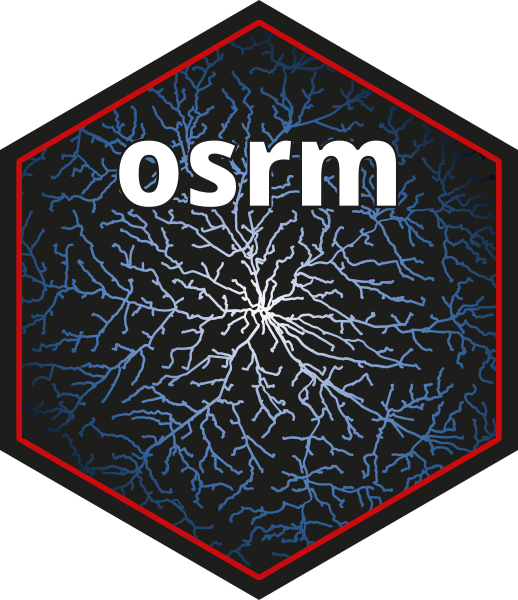

**&#9888; This project has moved to a new location: https://codeberg.org/riatelab/osrm/ &#9888;**

# osrm 

[OSRM](http://project-osrm.org/) is a routing service based on OpenStreetMap data.   
This package enables the computation of routes, trips, isochrones and travel 
distances matrices (travel time and kilometric distance) with R.

